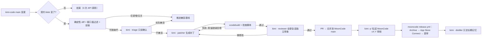

# mooncode-bot

> 让 [MoonCode](https://github.com/qkunio/mooncode)（iOS 原生 Kimi Code 远程控制客户端）**自动跟上** [Kimi Code](https://github.com/MoonshotAI/kimi-code) 的协议迭代。

## 解决什么问题

Kimi Code 迭代非常快（main 分支一天几十个提交），MoonCode 一直紧跟上游做兼容。过去每次都要人工发现“又不兼容了”，
再向 AI 从头解释一遍：链路是什么、哪些接口被用到、上次怎么兼容的、新旧版本要怎么共存……费心费力。

mooncode-bot 把这件事变成一条**自动调度流水线**：



- **检测不用 AI**：上游在 `packages/kap-server/schema/contract.txt` 里维护“一行一个字段”的 KAP 契约。bot 对比
  「已确认兼容的基线」与 main HEAD 的契约，过滤到 MoonCode 真正用到的接口（从 Swift 源码自动扫描），按规则定级。
  绝大多数上游提交连契约都不碰，直接跳过。
- **AI 只做判断与改代码**：底层 agent 全部是 `kimi`（Kimi Code CLI 的 print 模式），每个阶段一个独立会话。
- **构建与提审复用 MoonCode 现有的 GitHub Actions**：bot 只负责推一个带注释的 `v*` Tag，
  `release.yml` 直连 App Store Connect 完成构建、上传和提审。

## 核心：上下文管理

这个项目本质上是一个**上下文组织者**——它不让任何一个 agent 背负整条流水线的历史。详见 [docs/CONTEXT.md](docs/CONTEXT.md)。

| 层 | 内容 | 生命周期 | 体量 |
|---|---|---|---|
| L0 宪法 | `agents/*.md` 系统提示词 + `skills/` | 固定 | ~1–2k tokens |
| L1 长期记忆 | `memory/ledger.md`（兼容史与模式）+ 最近 3 条 `memory/episodes/` | 跨运行，distiller 维护，硬上限 | ≤12k 字符 |
| L2 任务包 | 编排器为**每个阶段**按预算装配的 ContextPack | 单阶段 | 按阶段 5k–30k tokens |
| L3 工作上下文 | kimi 会话内部的推理与工具调用 | 阶段结束即丢弃 | — |

阶段之间**只传结构化 handoff JSON**，不传对话；构建日志先蒸馏成错误摘要再回喂；审查者用全新会话；
每个上下文包都落盘 `manifest.json`，可以精确回答“当时 agent 看到了什么”。

## 目录

```
bot/                 编排器（纯 Python 标准库，3.9+）
  pipeline.py        调度主流程
  contract.py        KAP 契约 diff 与定级（确定性）
  surface.py         扫描 MoonCode 使用的接口面 → memory/surface.json
  kimi.py            kimi -p 执行器（stream-json、会话续接、handoff 读取）
  context/           上下文管理层：budget / pack / memory / logs
agents/              kimi agent 定义：triage / patcher / reviewer / releaser / distiller
skills/              kimi 技能：kap-compat（适配套路）、mooncode-release（提审步骤）
memory/              长期记忆（会被 bot 自动 commit）
state/state.json     兼容基线、在途适配、最近发版
.github/workflows/   watch.yml（每 15 分钟调度）、ci.yml（单测）
scripts/             install-launchd.sh（本机定时运行）
```

## 快速开始（本机）

```bash
cd ~/Documents/horizon/mooncode-bot

python3 -m bot surface -v                                  # 看看 MoonCode 用了哪些接口
python3 -m bot detect --base @moonshot-ai/kimi-code@2.7.2  # 只看差异，不改任何东西
python3 -m bot seed @moonshot-ai/kimi-code@2.7.2           # 设定兼容基线（MoonCode 1.9 已适配 2.7.2）
python3 -m bot tick --dry-run                              # 完整演练：会调用 kimi、本地出补丁并构建，但不 push
BOT_ARMED=true python3 -m bot tick                         # 真正执行：PR → 合并 → 拉起提审
python3 -m bot status
python3 -m bot release --notes "适配最新版 Kimi Code"       # 手动让 kimi 拉起一次提审
```

本机定时运行：`./scripts/install-launchd.sh`（演练）或 `./scripts/install-launchd.sh --armed`。

## 云端运行（GitHub Actions）

`watch.yml` 每 15 分钟在 `ubuntu-latest` 上探测一次（只读 2 个 API）。只有契约变了**且**仓库变量 `BOT_ARMED=true`
时才会拉起 `macos-26` runner 执行适配；手动触发（`workflow_dispatch`）默认 `dry_run=true`。

需要配置：

| 类型 | 名称 | 说明 |
|---|---|---|
| Secret | `MOONCODE_TOKEN` | Fine-grained PAT，仓库 `qkunio/mooncode` 的 Contents / Pull requests / Actions 读写权限。必须是 PAT（`GITHUB_TOKEN` 推的 Tag 不会触发 `release.yml`）。 |
| Secret | `KIMI_CONFIG_TOML` | 写入 CI 中 `$KIMI_CODE_HOME/config.toml` 的完整内容（带 `[providers.*]` API Key 与 `default_model`）。 |
| Variable | `BOT_ARMED` | `true` 后定时任务才会产生副作用（push / merge / 打 Tag / 提交 state）。 |

App Store Connect 的 6 个 Secrets 仍在 MoonCode 仓库的 `appstore-release` Environment 中，bot 从不接触。

## 安全闸

- 不武装（`BOT_ARMED` ≠ `true`）时：不 push、不合并、不打 Tag、不写 state。
- 只读阶段（triage / review）若改了工作区，编排器直接回滚并判失败。
- 同一份契约连续失败 2 次 → 标记 `blocked`，不再每 15 分钟烧 token，等待人工或上游新变更。
- releaser 声称完成后，编排器独立核验远端 Tag 与 `release.yml` 运行是否存在。
- 配置 `ship.auto_merge=false` 可改为“只开 PR，人工合并后自动提审”；`release.auto=false` 可关闭自动提审。
