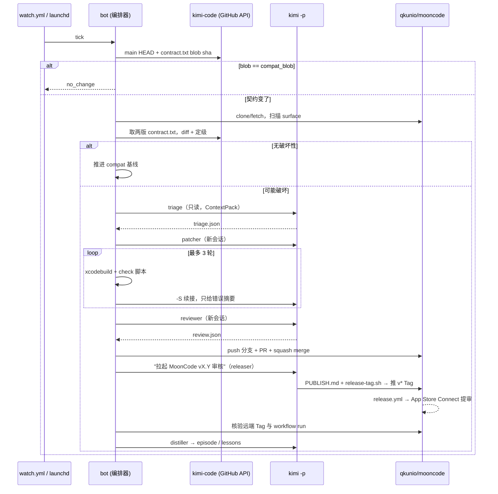

# 架构

## 角色与边界

| 组件 | 负责 | 不负责 |
|---|---|---|
| `bot/`（编排器，确定性 Python） | 探测、契约 diff、定级、上下文装配、调用 kimi、构建验证、git/PR、状态与记忆持久化、核验 agent 的声称 | 判断语义影响、写 Swift |
| `kimi`（Kimi Code CLI，`-p` print 模式） | 分诊、改代码、审查、写更新日志并拉起提审、沉淀记忆 | 决定流程走向、读写 state |
| MoonCode `release.yml` | Archive → 上传 App Store Connect → 写更新日志 → 提审 | — |

原则：**流程由代码决定，判断由 AI 完成，事实由代码核验。**

## 一次 tick

## 定级规则（`bot/contract.py`）

| 变更 | 级别 |
|---|---|
| MoonCode 使用的路由 / WS 消息被删除 | breaking |
| 新增必填请求字段（父对象原本就存在且无可选祖先） | breaking |
| 请求字段删除 / 类型变化 | likely_breaking |
| 响应字段删除、类型变化、枚举取值变化、变为可选 | likely_breaking |
| shape 换号：递归比较新旧 shape 字段，按最坏的子变更定级 | 视情况 |
| 新增可选字段 / 新增接口 / 新增响应字段 | additive（不触发适配） |
| MoonCode 未使用的接口 | ignored |

breaking / likely_breaking 才会进入 AI 分诊；分诊判定“实际兼容”也会直接推进基线，不会改代码。

## 状态机（`state/state.json`）

- `upstream.compat_sha / compat_blob`：已确认兼容的契约基线。检测永远是 `compat → HEAD`，多次上游变更会累积到一次适配里。
- `inflight`：在途适配（`adapting` / `awaiting_merge`），带 `attempts` 计数；同一份契约失败 2 次即 `blocked`。
- 上游契约在 PR 待合并期间又变了：关闭旧 PR，基于最新 main 重新适配（新会话、新上下文，不在旧补丁上叠补丁）。
- `history`：最近 40 条有意义的运行结果（无变化的 tick 不记录，避免 state 噪音提交）。

## 运行环境

- **GitHub Actions**：`probe`（ubuntu，几秒）→ 仅在需要时 `adapt`（macos-26，含 Xcode）。kimi 通过 `npm i -g @moonshot-ai/kimi-code`
  安装，配置来自 `KIMI_CONFIG_TOML` secret。运行产物（上下文包、transcript、构建日志）作为 artifact 保留 30 天。
- **本机 launchd**：复用本机 Xcode、kimi 登录态与 gh 钥匙串，`scripts/install-launchd.sh`。
