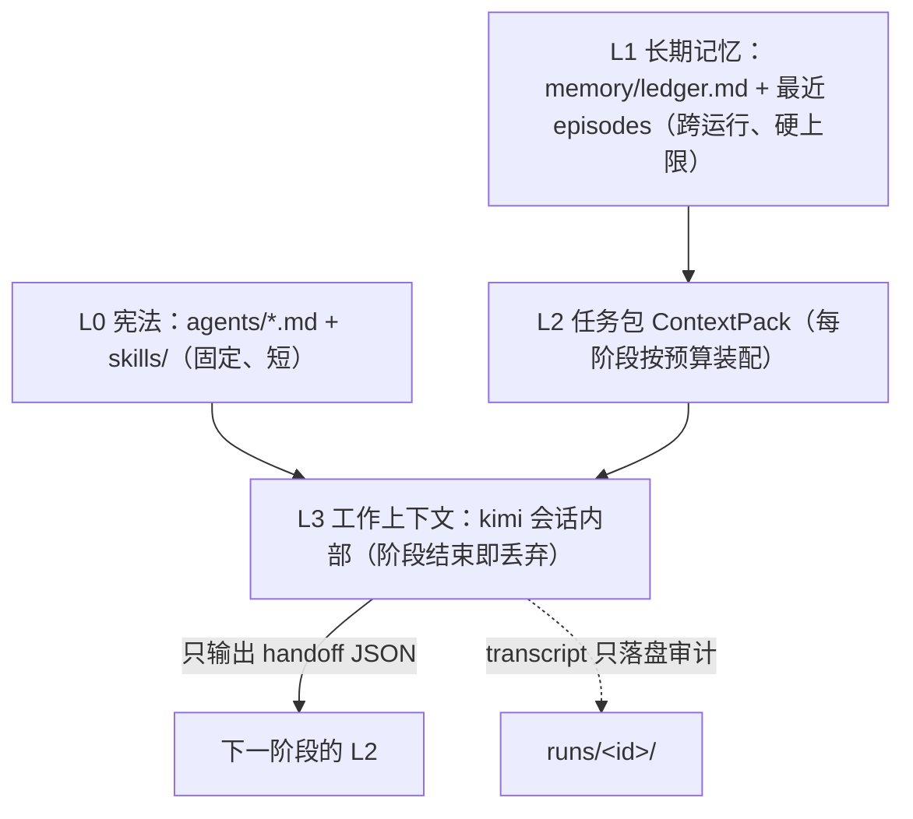

# 上下文管理设计

mooncode-bot 的价值不在“调用了 AI”，而在于**每次调用 AI 时，它看到的恰好是完成这一步所需的东西，不多不少**。
过去人工和 AI 沟通兼容问题之所以累，是因为每次都要重新组织上下文；这里把“组织上下文”变成代码。

## 1. 四层上下文



- **L0 宪法**：角色、硬规则（向后兼容、不碰签名与密钥、不 push）、handoff 格式。通过 `--agent-file` 作为系统提示词注入；
  可复用的操作知识放进 `skills/`（`--skills-dir`），由 kimi 按需加载，而不是每次塞进提示词。
- **L1 长期记忆**：`memory/ledger.md` 是“兼容史 + 适配模式 + 不变量”的浓缩版，替代了过去每次都要向 AI 重讲的那段背景。
  `memory/episodes/` 每次运行一条 ≤300 字摘要，只取最近 3 条。
- **L2 任务包**：编排器为每个阶段拼装，详见下文。
- **L3 工作上下文**：kimi 在自己会话里的推理、读文件、跑命令。**永不**向下游传递。

## 2. ContextPack：按优先级 + 预算装箱

`bot/context/pack.py`。每个 section 带 `priority`（越小越重要）、`min_tokens`、可选 `source`（磁盘路径）。

1. 按优先级把放得下的 section 整段放入；
2. 放不下的截断到剩余预算（在行边界切），并注明“完整内容见 `<source>`”；
3. 预算耗尽后的 section 丢弃，若有 `source` 则只留一个指针，agent 真需要时自己 Read；
4. 渲染顺序保持添加顺序（阅读自然），装箱顺序按优先级（保证关键内容在）。

每个包落盘为 `runs/<id>/<stage>/context.md` + `manifest.json`（各段 token、是否截断/丢弃）。出问题时可以精确复盘
“agent 当时看到了什么、没看到什么”。

各阶段预算（`config/bot.json → context.budget_tokens`）与内容：

| 阶段 | 预算 | P0 | P1 | P2 | P3+ |
|---|---|---|---|---|---|
| triage | 24k | 任务 + handoff 路径 | 过滤后的契约差异 + 源码指针 | 上游 PR 意图 | ledger、shape 展开、kap.md diff、episodes、已忽略操作 |
| patch | 30k | 任务 + 完成标准 | triage 结论、验证命令 | 相关契约差异 + 指针 | ledger、episodes |
| fix | 6k | “只修这些” | 蒸馏后的错误摘要 | — | 原始日志仅指针 |
| review | 22k | 审查任务 | triage 结论 | 按文件截断的 diff | ledger |
| release | 5k | 版本/Tag/PR | 更新日志素材 | — | — |
| distill | 8k | 任务 | 本次运行结构化记录 | 当前 ledger | — |

## 3. 给指针，不给全文

MoonCode 有约 2 万行 Swift。`bot/surface.py` 扫描源码得到“MoonCode 用到的每个 REST 路由 / WS 消息 → 源码位置”，
存为 `memory/surface.json`。它有两个用途：

- **过滤**：契约 diff 只保留 MoonCode 用到的部分（上游一次改动常常涉及几百行契约，真正相关的往往只有几行）；
- **指针**：上下文包里每个变更都附 `MoonCode 位置：KimiCode/Core/KapClient.swift:291`。agent 按图索骥地读几十行，
  而不是通读整个仓库。大范围探索交给 kimi 的 `explore` subagent，结论回流、过程不回流。

## 4. 阶段隔离与 handoff

每个 AI 阶段 = 一次全新的 `kimi -p` 会话，输入是 L2 包，输出是一个 JSON handoff（字段在 agent 定义里约定，
编排器校验必填字段）。阶段间只传 handoff：

```
detect.json ──► triage.json ──► patch.json ──► review.json ──► release.json
                                   ▲    │
                      错误摘要 (fix) │    ▼
                                 verify（确定性）
```

- **同阶段续接**：patch 的修复轮次用 `kimi -S <session_id>` 续接同一会话——它需要记得自己刚才改了什么；
  但每轮只追加一份 ≤6k tokens 的错误摘要，而不是整份日志。
- **跨阶段隔离**：reviewer 永远是新会话，看不到 patcher 的思考过程，只看「待适配项 + diff」——这是刻意的，
  避免“自己审自己”。
- **只读护栏**：triage / review 结束后编排器检查 `git status`，被改过即回滚并判失败。

## 5. 日志蒸馏

`bot/context/logs.py`：xcodebuild 动辄几万行。只提取 `file:line:col: error:` 行（去重、转为仓库相对路径、带 2 行源码上下文）
和 `** BUILD FAILED **`、测试断言等，压到 ≤6k 字符。原始日志落盘 `runs/<id>/verify-N.log`，摘要里给出路径。

## 6. 记忆的写入与压缩

每次涉及 AI 的运行结束（成功或失败）后，distiller 阶段（无工具、只能写 handoff）产出：

- `episode`：≤300 字摘要 → `memory/episodes/<run>.md`；
- `lessons`：0~5 条可复用经验 → 去重后追加到 ledger 的「自动沉淀的经验」；
- ledger 超过 `ledger_max_chars` 时，额外要求输出 `ledger_rewrite`：压缩到上限的 70%，合并同类项、删除过时细节。

记忆随 `state/` 一起由 bot commit 回本仓库，所以它是**可审阅、可回滚、可人工编辑**的。

## 7. 什么不进上下文

- kimi 的完整事件流（`*.transcript.jsonl`）——只用于审计，CI 中作为 artifact 保留 30 天；
- 原始构建日志；
- 上游与 MoonCode 无关的契约变更（只给一个操作名列表，最低优先级）；
- 任何密钥。App Store Connect 凭证只存在于 MoonCode 仓库的 GitHub Environment 中。
